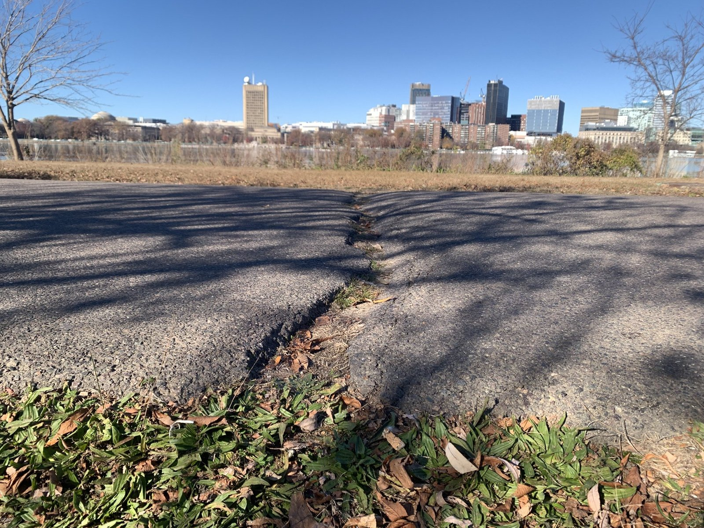
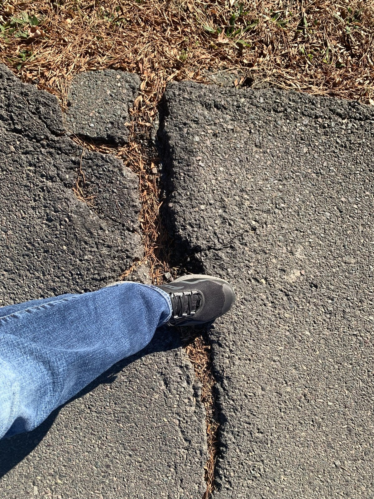

# A crack on a shared path (Boston Esplanade, 2026)

*The crack on June 1, 2026. Photo by the author.*

On March 11, 2026, I fell from an electric skateboard after hitting this crack on the Dr. Paul Dudley White Path, a walking and bike path along the Charles River on the Boston side, roughly between the Hatch Shell and the Harvard (Mass Ave) Bridge. A helmet and gloves prevented serious injury. I photographed the crack again on June 1, nearly three months later; it was still there.

I was riding a skateboard with larger wheels than most, and I still fell. Many people on this path depend on wheels much smaller than mine. A manual wheelchair's big rear wheels can roll over a crack like this, but its small front wheels can drop in or catch on the raised edge, and a sudden stop can tip the chair forward. Power wheelchairs, mobility scooters, rollators and strollers all have small wheels too, and so do electric scooters and one-wheels. For people on foot, the raised edge is a trip hazard, especially for older people and people with low vision. Gear can protect a skateboarder; most of these people don't have that option. The fix has to be the path itself.

This path is not on a route to a research or care site; it is a place people go for exercise and to get around. But the same kind of shared path is part of the routes in this project: in Somerville, the Community Path is the walking route to Davis station and to a clinic in Davis Square, and the [November 16 re-check](../reports/Davis_NorthCambridge_Recheck_Report_2026-11-16.pdf) found a large pothole on it by the Buena Vista Rd crossing.

The path is managed by the Massachusetts Department of Conservation and Recreation (DCR).

## Update: November 19, 2026

*The same crack on November 19, 2026, about eight months after the fall. Photo by the author.*

I walked back to the spot on November 19. The crack is still there and has not been repaired: same shape, same raised edge, with grass growing in the gap. The view across the river matches the June 1 photo.

It is not the only one. Walking east from it toward the Lagoon, a crack of the same kind crosses the path from the grass edge every few metres. Some further east are wider and more broken, with loose pieces of asphalt.

*One of the wider cracks a short walk east of the fall site, November 19, 2026, with a shoe for scale. Photo by the author.*

I did not have a tape measure. Judging from the shoe, the widest gaps look about 1.5 to 2.5 inches wide; that is an estimate, not a measurement. That is wide enough for a cane tip or a small front wheel to drop in, and this one runs along the direction of travel, so a wheel can follow it.

Why this matters for research, even though this path is not a route to a study site: people judge a trip by what they meet on the way. Someone who uses a wheelchair or a cane and finds the same cracks unrepaired month after month on a weekend outing may become more cautious about every trip, including an optional visit to a research study. Barriers that stay in place teach people to stay home. The [re-check reports](../reports/README.md) in this project look at the same question on routes to care sites: whether reported problems get fixed.

Measurements with a tape will be added if I return with one.

This note is part of the [Route to Research](../README.md) project. Corrections are welcome: uri.kartoun@dbbun.com
