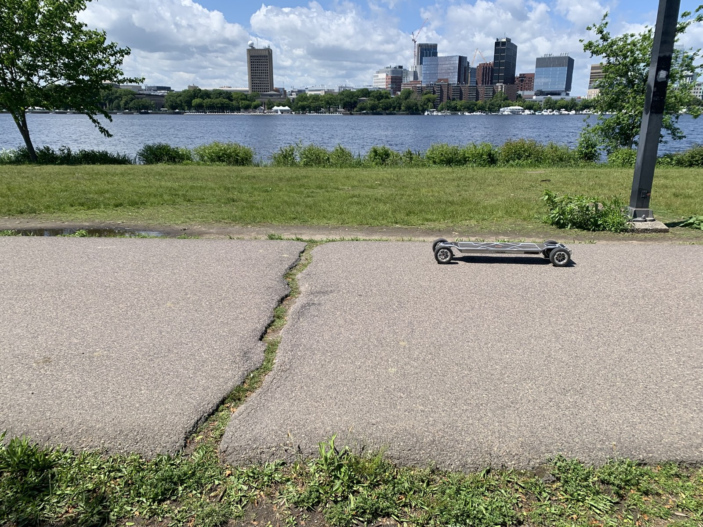

# A crack on a shared path (Boston Esplanade, 2026)

*The crack on June 1, 2026. Photo by the author.*

On March 11, 2026, I fell from an electric skateboard after hitting this crack on the Dr. Paul Dudley White Path, a walking and bike path along the Charles River on the Boston side, roughly between the Hatch Shell and the Harvard (Mass Ave) Bridge. A helmet and gloves prevented serious injury. I photographed the crack again on June 1, nearly three months later; it was still there.

For a wheelchair's small front wheels, or the wheels of a walker or rollator, a crack like this is the same hazard: a wheel drops in, stops, and the person can be pitched forward. Gear can protect a skateboarder; a wheelchair user doesn't have that option. The fix has to be the path itself.

The path is managed by the Massachusetts Department of Conservation and Recreation (DCR). Whether the crack has been repaired since June 1 is not known.

This note is part of the [Route to Research](../README.md) project. Corrections are welcome: uri.kartoun@dbbun.com
